# DramaFlow

**AI 短剧生成提效工具** — 从剧本到成片的一站式工作台。

[](LICENSE)


DramaFlow is an AI-powered production workflow for short dramas: script → storyboard → characters → dubbing → final render, all in one workspace.

> **当前状态**：核心链路已跑通，可产出完整成片。真实文生图（通义万相）、云端 TTS（DashScope CosyVoice）、文生视频、本地 FFmpeg 合成均已接入；未配置 API Key 时使用内置「模拟 AI」离线模式，同样能跑通全流程。

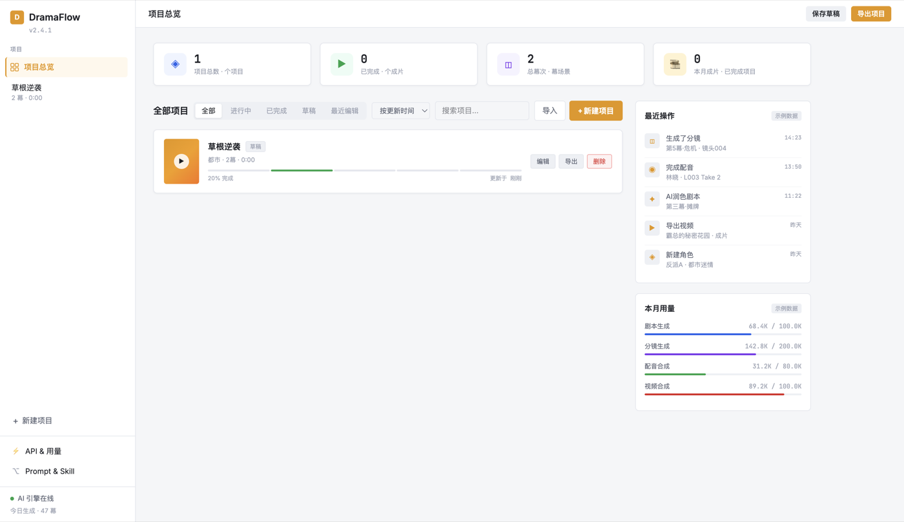

## 📸 真实使用效果

以下素材全部来自一次真实创作：都市题材短剧《草根逆袭》——18 个镜头、11 位角色、21 段配音，最终合成 **1080×1920 竖屏成片，时长 2 分 35 秒**。

### ① 一键生成结构化剧本

输入一句创意，AI 直接产出可直接解析落库的分幕剧本：场景描述 + 角色 + 情绪 + 台词。剧本、分镜、人设、优化建议等每个环节的系统提示词都可在「Prompt & Skill」页自定义。

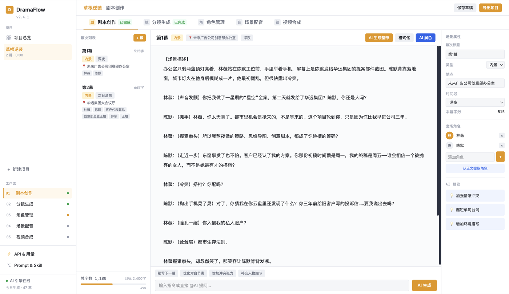

真实产出片段（第 1 幕）：

> **【场景描述】** 办公室只剩两盏顶灯亮着，林薇站在陈默工位前，手里举着手机，屏幕上是陈默发给华远集团的提案邮件截图……
>
> **林薇**：（声音发颤）你把我做了一星期的"星空"全案，第二天就发给了华远集团？陈默，你还是人吗？
>
> **陈默**：（摊手）林薇，你太天真了。都市里机会是抢来的，不是等来的。

### ② 文生图生成分镜画面

按镜头逐条调用文生图模型，生成统一电影感调性的分镜画面，并支持重绘与直接转视频：

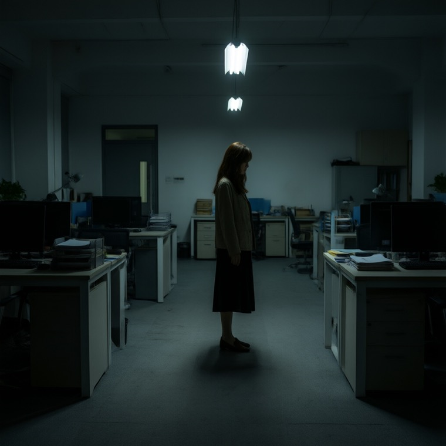 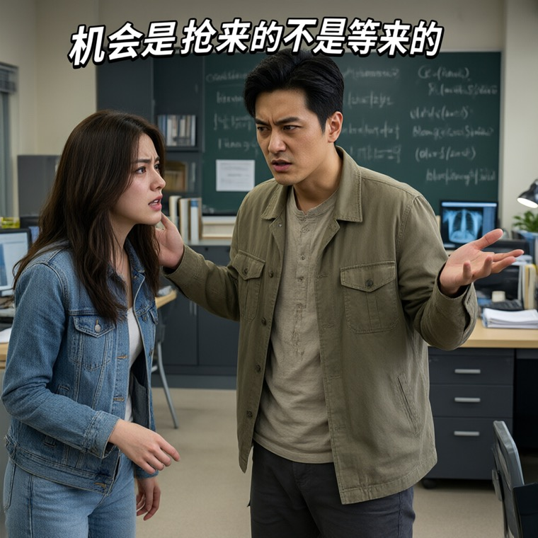 

对应镜头：

| 镜头 | 类型 / 角度 | 画面内容 |
|------|------------|----------|
| `#1-01` | 全景 · 平视 | 办公室内仅两盏顶灯亮着，昏暗空旷，林薇站在陈默工位前，身影被灯光拉长 |
| `#1-02` | 中景 · 平视 | 林薇声音发颤质问陈默，陈默摊手冷笑 |
| `#1-03` | 近景 · 微仰 | 林薇握紧拳头，愤恨地燃起熬夜做的策略 |

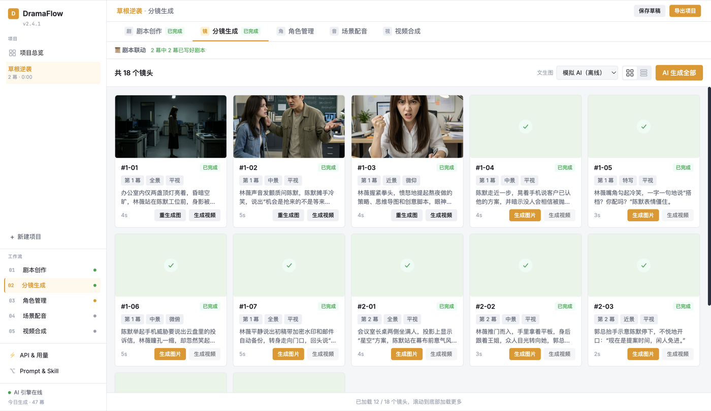

### ③ 角色形象与配音

角色档案支持形象生成（文生图）、声音设定（音色 / 情绪 / 语速 / 音量），并可参考图锁定形象一致性：

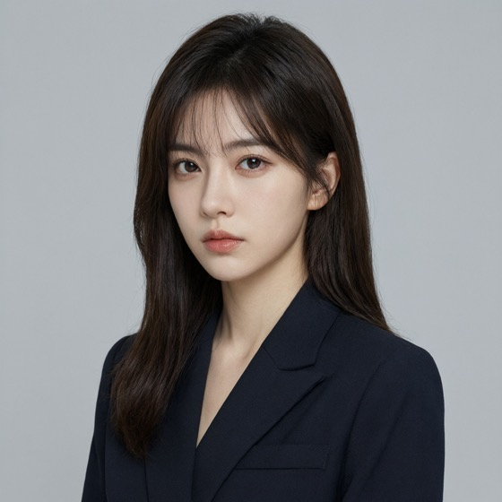 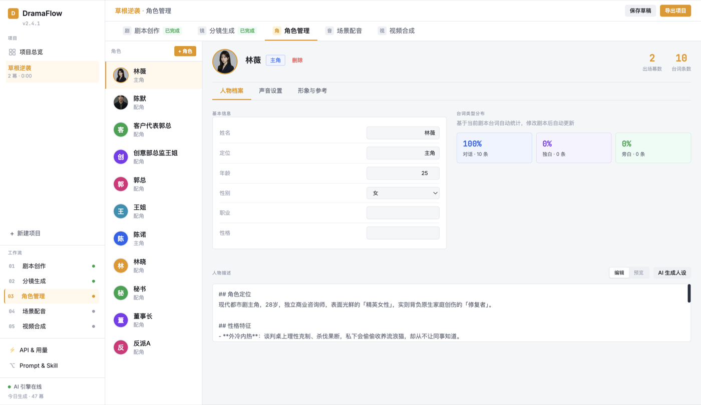

台词批量配音，逐条可试听、可调情绪与语速，支持 macOS 系统音色、DashScope Qwen-TTS / CosyVoice 等：

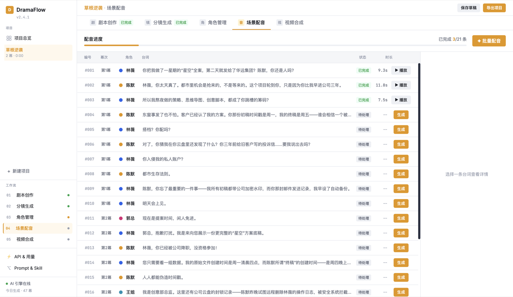

### ④ FFmpeg 本地合成成片

桌面端调用本地 FFmpeg 真实渲染：分镜图 Ken Burns 运镜、AI 视频片段拼接、配音与字幕烧录、背景音乐混音、色调统一、片头片尾。下图是成片预览动图与真实画面帧：

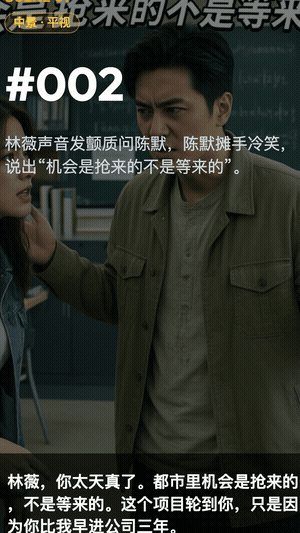

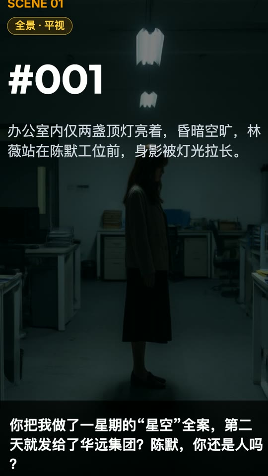 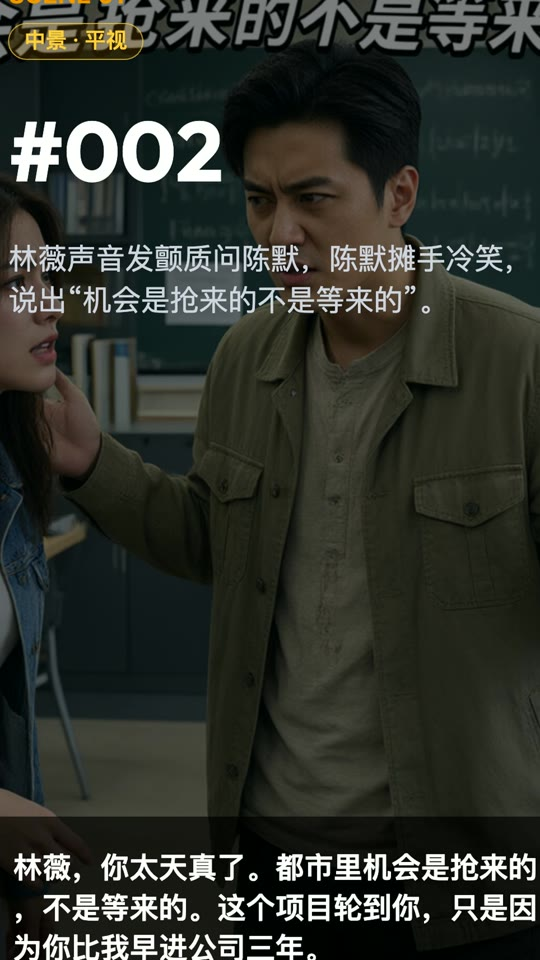 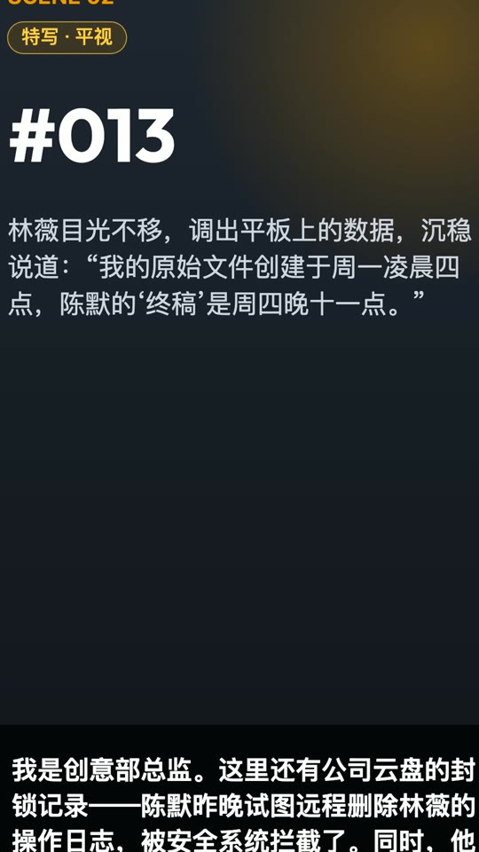 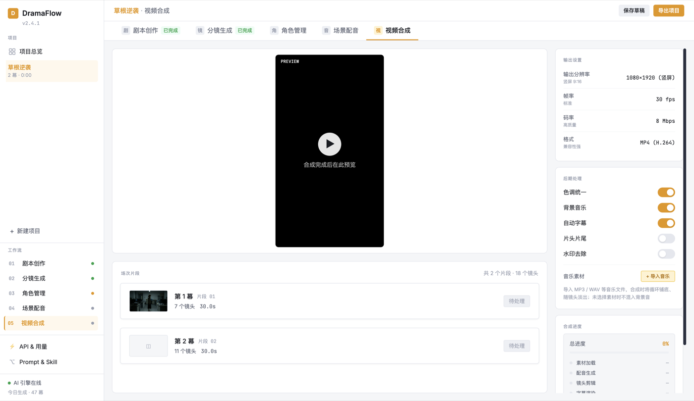

成片画面包含镜头编号与类型标注、场景描述、以及随配音时长自动生成的字幕。

## ✨ 功能亮点

- **项目总览** — 多项目卡片式管理，统计卡片（项目数 / 成片数 / 总幕次 / 累计消耗）、完成度分段进度条、近期动态与本月用量
- **剧本创作** — 幕次管理、三栏编辑、AI 生成整部剧本、单幕续写与润色（结构化解析落库）
- **分镜生成** — 网格/列表视图、从剧本逐幕批量生成镜头、文生图批量生成画面、镜头一键转视频
- **角色管理** — 人物档案、形象生成与参考图、声音设置、角色一致性检查
- **场景配音** — 台词批量配音、情绪/语速/音量调节、逐条试听
- **视频合成** — 本地真实合成（FFmpeg H.264 + 配音 + 字幕 + BGM 混音 + 色调统一 + 片头片尾），输出设置、进度跟踪、预览与导出
- **API & 用量** — 多模型管理、按专业用途（剧本 / 分镜 / 人设 / 配音 / 文生图 / 视频）分配默认模型、连接测试
- **Prompt & Skill** — Prompt 模板库（内置 6 个模板，可增删改、按用途启用，直接作为生成系统提示词）+ Skill 编排流水线
- **多模型 BYOK** — 自带 API Key 接入 OpenAI 兼容服务（DeepSeek / 通义千问 / 智谱 GLM / OpenAI）与 DashScope 原生能力，支持按用途切换模型
- **项目备份** — 一键导出/导入完整项目（含分镜图 / 角色形象 / 配音音频 / BGM 素材）
- **Web + 桌面双形态** — 浏览器直接使用，也可打包为 Electron 桌面应用

## 🔄 完整工作流

| 剧本创作 | 分镜生成 |
|---------|---------|
|  |  |
| **角色管理** | **场景配音** |
|  |  |

**视频合成**


## ⚙️ 模型与提示词配置

| 模型配置 | 默认模型分配 |
|---------|-------------|
| 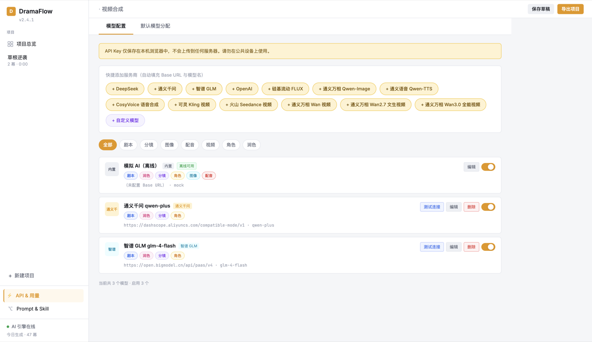 | 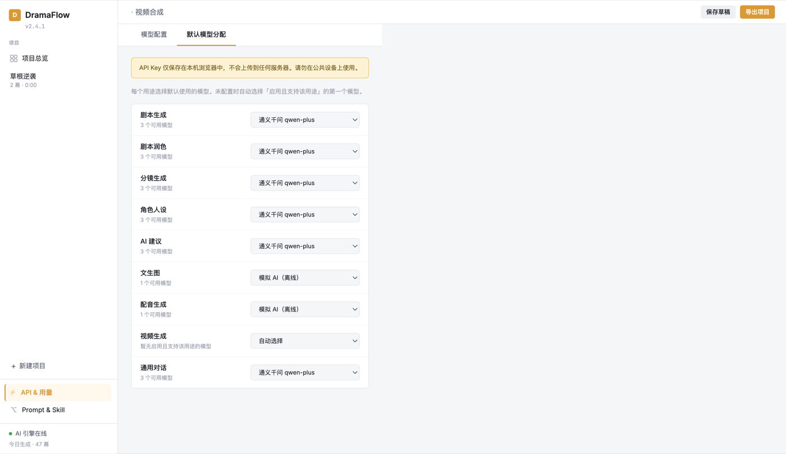 |

| Prompt 管理 | Skill 编排 |
|------------|-----------|
| 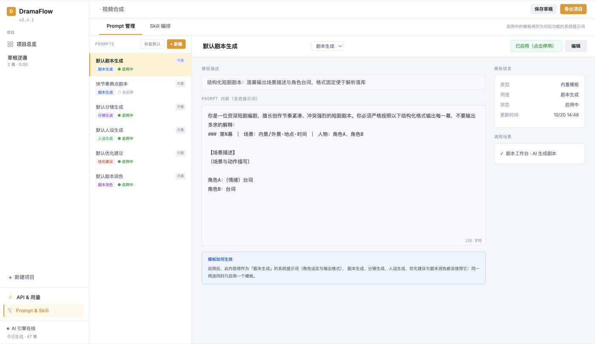 | 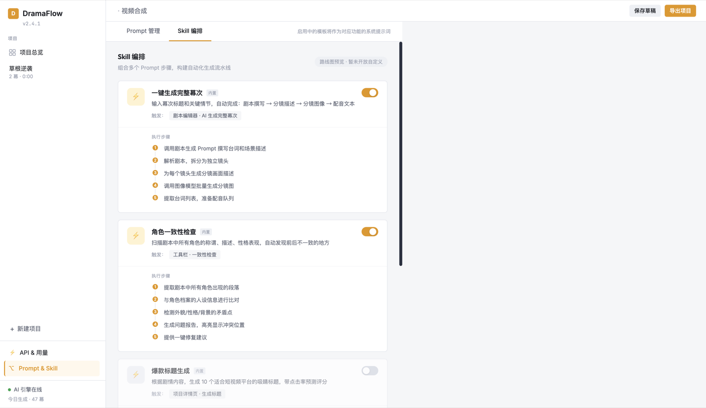 |

## 🚀 快速开始

环境要求：Node.js ≥ 18

```bash
cd dramaflow-app
npm install

# Web 版（浏览器访问 http://localhost:5173）
npm run dev:web

# 桌面版（Electron，支持本地合成与原生文件读写）
npm run dev

# 生产构建
npm run build

# 桌面打包
npm run build:desktop
```

> 首次打开默认使用「模拟 AI」模式，无需任何配置即可体验完整流程。在侧边栏进入「API & 用量」填入自己的 API Key，即可切换到真实生成。

## 📦 技术栈

| 类别 | 技术 |
|------|------|
| 前端 | React 19 · TypeScript · Vite · Tailwind CSS v4 |
| 状态管理 | Zustand |
| 本地数据 | localStorage + Dexie（IndexedDB，存图片/音频 Blob） |
| 桌面端 | Electron + electron-builder + electron-updater |
| 视频合成 | 本地 FFmpeg（H.264 + AAC，Ken Burns 运镜、字幕烧录、混音） |
| AI 接入 | OpenAI 兼容 API + DashScope（通义万相文生图 / 文生视频、CosyVoice TTS） |

## 🗂 项目结构

```
DramaFlow/
├── dramaflow-app/              # 主应用（唯一正式代码库）
│   ├── electron/               # Electron 主进程、预加载脚本、FFmpeg 合成
│   └── src/
│       ├── components/         # 业务组件（总览 / 五大工作台 / API / Prompt）
│       ├── data/               # 类型、存储层、Prompt 库、项目备份
│       ├── services/           # AI 服务抽象层（可插拔多模型与视频/TTS 适配）
│       └── store/              # Zustand 状态管理
├── docs/                       # README 使用的真实产出截图与素材
├── archive/                    # 已归档的设计原型与素材
├── DramaFlow-需求文档.md        # 产品需求文档
├── DramaFlow-开发任务计划.md    # 开发路线图
├── LICENSE
└── README.md
```

## 🤖 AI 模型配置

应用通过统一的 [AI 服务抽象层](dramaflow-app/src/services/ai.ts) 按用途路由模型，兼容所有 OpenAI Chat Completions 格式的服务。

支持一键添加 DeepSeek / 通义千问 / 智谱 GLM / OpenAI 预设，以及通义万相文生图、CosyVoice 语音合成等 DashScope 原生模型，填好 Key 后可直接「测试连接」。未配置 Key 时使用内置模拟模型，同样可以体验完整流程。

| 用途 | 说明 |
|------|------|
| 剧本生成 / 润色 | LLM 对话 |
| 分镜 / 人设 / 建议 | LLM 对话 |
| 文生图 | 分镜图、角色形象 |
| 配音 | TTS（系统音色 / Qwen-TTS / CosyVoice） |
| 视频 | 文生视频、图生视频 |

**BYOK（自带 Key）**：模型配置保存在本地，不经过任何服务器；请在各服务商官方渠道申请 Key，并妥善保管。

## 🛣 路线图

见 [DramaFlow 开发任务计划](DramaFlow-开发任务计划.md)：开源发布 → 托管服务（账号 / 积分 / 订阅）→ 模板市场 / 团队协作 / 私有化部署。

## 🤝 参与贡献

欢迎提交 Issue 与 PR。请阅读 [CONTRIBUTING](CONTRIBUTING.md) 与 [行为准则](CODE_OF_CONDUCT.md)。

## 📄 许可证

本项目采用 **AGPL-3.0** 开源许可证，详见 [LICENSE](LICENSE)。商业使用 / 托管服务授权请联系项目维护者。
